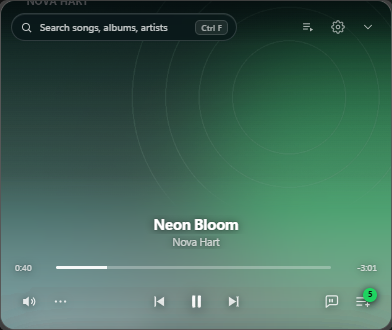
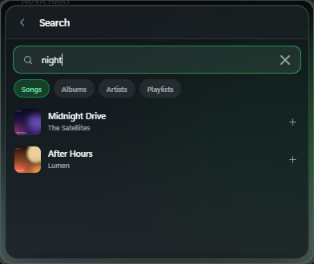
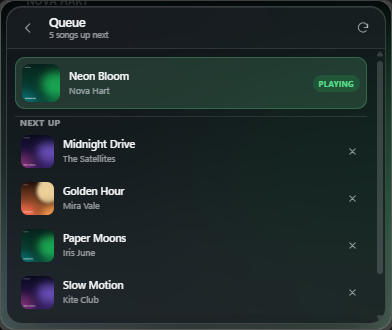
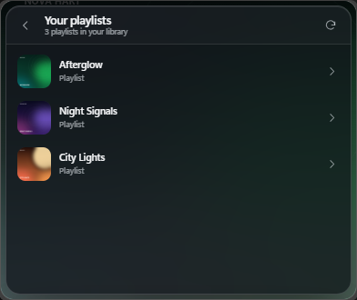
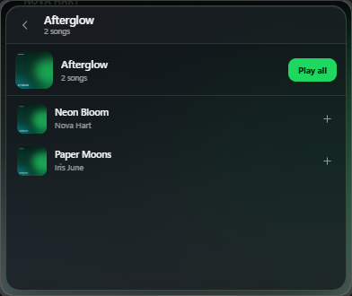
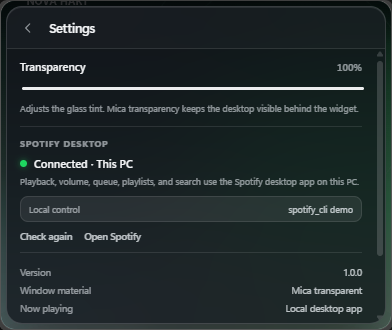
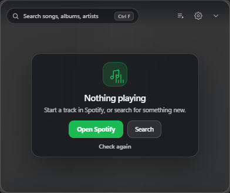
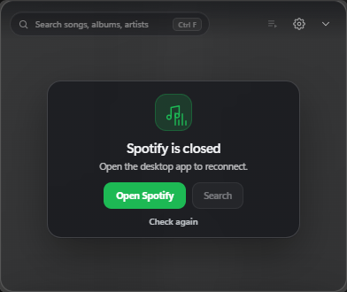
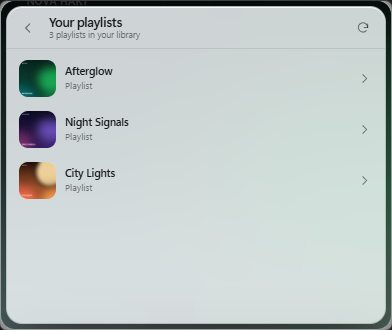

# Spotify Mini Player

A minimalist, always-on-top Spotify widget for Windows 11. It stays out of the way in the
tray, shows the current track on a full-bleed artwork card, and gives you the handful of
controls you actually need: play/pause, previous/next, seek, volume, the queue, playlists,
and search.

Built with Electron. **No account setup, API keys, or Spotify developer app.** The widget
reads and controls the Spotify desktop app installed on your PC. If Spotify is closed, it
keeps the last track visible and can launch Spotify for you.



| Search | Queue |
| --- | --- |
|  |  |

| Playlists | Playlist detail | Settings |
| --- | --- | --- |
|  |  |  |

| Nothing playing | Spotify closed | Light theme |
| --- | --- | --- |
|  |  |  |

## How it works

Spotify for Windows ships a local helper called `spotify_cli.exe` next to `Spotify.exe`.
It talks to the running desktop client through Spotify's own local session, so the widget
can read the current song, control playback, browse the queue, search the catalog, and list
your playlists without asking you to sign in again.

The helper does not expose a playback position, so the widget reads the Windows media
timeline (SMTC) through a small local PowerShell helper. It selects Spotify's media
session even when another app is the active media source, so the progress bar stays
accurate. That only fills in the progress bar; playback commands still go through Spotify.

The widget discovers the helper automatically in the usual install locations:

- `%APPDATA%\Spotify\spotify_cli.exe`
- `%LOCALAPPDATA%\Spotify\spotify_cli.exe`
- `%LOCALAPPDATA%\Programs\Spotify\spotify_cli.exe`
- `%LOCALAPPDATA%\Microsoft\WindowsApps\spotify_cli.exe`
- `%ProgramFiles%\Spotify\spotify_cli.exe`
- `%ProgramFiles(x86)%\Spotify\spotify_cli.exe`

Set `SPOTIFY_CLI_PATH` to an explicit path if Spotify lives somewhere else.

The helper is an undocumented part of the Spotify desktop app. It is not a public Spotify
API and may change between Spotify updates. The widget reports a clear error instead of
crashing if the helper is missing or returns something unexpected.

### Window material

The design is built around **Mica transparent** glass: a full-bleed cover, a light frosted
bottom overlay, and translucent sheets. The UI labels the material "Mica transparent".

Under the hood the widget applies the native Windows **Acrylic** backdrop. Mica samples the
system wallpaper, but live wallpaper tools such as Wallpaper Engine draw their own window
and leave the system wallpaper black, which makes Mica render as a flat panel. Acrylic
samples the windows behind the widget instead, so the glass effect survives animated
wallpapers. Both are native DWM materials; the Transparency slider adjusts a renderer tint
layer without replacing the backdrop.

## Features

- **Horizontal artwork card** — a 392 × 330 px frameless widget with full-bleed cover art,
  centered title/artist, elapsed and remaining time, and a seekable progress bar.
- **Mica transparent glass** — native Acrylic-backed transparency with a tint-strength
  slider and a translucent blur fallback on older systems.
- **No account setup** — no browser login, tokens, Client ID, or `.env` file.
- **Live playback** — current track, artist, album, artwork, play state, and position.
  Polls every 2 seconds while visible and every 10 seconds while hidden.
- **Playback controls** — play/pause, previous, next, seek, and a 0–100 volume slider for
  the active Spotify device. Hover the volume button to open the slider.
- **Detailed search** — search songs, albums, artists, and playlists with filter chips;
  play a result or add a song to the queue.
- **Queue viewer** — shows the current track and upcoming songs with artwork for every
  queued track, lets you play an item, remove an item, or refresh the queue. Refreshes in
  the background about every 12 seconds.
- **Playlists** — browse your saved playlists, open a playlist to see its tracks, play the
  whole playlist, or play an individual track.
- **Album artwork crossfade** — new covers fade in over the previous cover at full
  resolution instead of stretching a thumbnail.
- **Adaptive accent color** — a vivid accent is extracted from the current cover and applied
  to buttons, sliders, and the ambient glow. A Spicetify theme accent takes precedence.
- **Spotify theme sync** — when Spicetify is installed, the widget reads the active theme's
  color scheme from local Spicetify files and matches its background, text, surfaces,
  accent, and playback bar, even while Spotify is closed.
- **Light and dark fallback** — without Spicetify, follows the Windows app theme
  automatically.
- **Tray integration** — show/hide, now-playing info, playback controls, search, playlists,
  queue, settings, open Spotify, and quit.
- **Persistent preferences** — window position and transparency are remembered across
  restarts.
- **Works while Spotify is closed** — keeps the last track, artwork, device, and volume on
  screen, disables controls that need the client, and turns the search pill into an
  **Open Spotify** action. Reconnects automatically when Spotify starts.
- **Clear states** — starting, Spotify closed, signed out of Spotify, and missing helper are
  handled without a login screen.
- **Accessible interactions** — keyboard shortcuts, focus trapping in sheets, ARIA labels,
  and reduced-motion support.

## Requirements

- **Windows 10 or 11.** The glass backdrop needs Windows 11 build 22621 or newer; the
  fallback works on Windows 10 and earlier Windows 11 builds.
- **Spotify for Windows installed.** The widget is a local remote control; it does not play
  audio itself. Spotify does not need to be running when you open the widget — use
  **Open Spotify** to launch it.
- **Signed in to the Spotify desktop app at least once.** The widget uses that existing
  session. Playback control, search, queue, and playlists need Spotify running.
- **Spotify Premium** for play/pause, skip, seek, and volume. This is a Spotify restriction,
  not a widget restriction. Free accounts may still see the current track.
- **Node.js 20+** (Node 22 LTS recommended) and npm for development.

## Install and run

```powershell
git clone <your-repo-url> spotify-mini-player
cd spotify-mini-player
npm install
npm start
```

Open Spotify and start a track. The widget connects automatically; there is no setup card
and no browser sign-in. If Spotify is closed, select **Open Spotify** in the widget or launch
Spotify yourself; the widget reconnects on its own.

### Demo mode

Try the UI without Spotify or an account:

```powershell
npm run demo
```

Demo mode uses generated cover art, a simulated queue, and demo playlists. It never calls
Spotify.

### Spotify theme sync

If [Spicetify](https://spicetify.app/) is installed, the widget matches the Spotify desktop
theme automatically. It reads the applied theme from
`%APPDATA%\Spotify\Apps\xpui\spicetify-config.json`, falling back to the Spicetify config
and the theme's `color.ini`. The background, text, surfaces, accent, and playback bar follow
the active color scheme; the layout and controls stay the same. This works while Spotify is
closed, refreshes every few seconds, and switches to the Windows light/dark theme when
Spicetify is unavailable. The widget only reads these files and never modifies them.

## Using the widget

- **Drag** the header, artwork, or empty areas of the card to move the window.
- **Search bar** or **Ctrl + F** opens the search sheet. Pick **Songs**, **Albums**,
  **Artists**, or **Playlists**, then click a result to play it or click **+** to queue a
  song.
- **Playlists button** opens your saved playlists. Click a playlist to see its tracks, use
  **Play all**, or play a single track.
- **Queue button** opens the queue sheet. Click a song to play it; click **×** to remove it
  from the upcoming queue.
- **Progress bar** seeks within the current track.
- **Volume button** opens the volume popover on hover; clicking it keeps the slider
  focused. **More** opens quick actions.
- **Quote button** opens track details (album, device, source, and what is up next).
- **Space** toggles play/pause when the player is focused and no text field is active.
- **Escape** closes the search results, popover, or open sheet.
- **Chevron** hides the widget to the tray. Closing the window also hides it instead of
  quitting.
- **Tray icon** toggles visibility. Right-click for now-playing details, playback controls,
  search, playlists, queue, settings, **Open Spotify**, and **Quit**.
- **Transparency slider** in Settings adjusts the strength of the glass tint and saves
  automatically. On the glass material the native window stays fully opaque so Windows can
  keep the backdrop visible; the slider changes a separate tint layer instead. The fallback
  theme uses whole-window opacity and keeps a 55% opaque floor so controls remain usable.

## Privacy and security

- **No Spotify credentials are stored.** There is no sign-in flow, refresh token, Client ID,
  or developer app. The widget uses the Spotify desktop app's existing local session.
- The config file at `%APPDATA%\Spotify Mini Player\config.json` stores only window position
  and opacity. Legacy credential fields are discarded when the file is loaded.
- The renderer runs sandboxed with `contextIsolation`, no Node.js integration, a strict CSP,
  and a fixed preload API. IPC handlers validate the sender frame.
- Album art is fetched from Spotify's image CDN (`i.scdn.co` and related Spotify CDN hosts).
  Playback, queue, search, and playlist commands go through the local Spotify helper.
- The playback position is read locally from Windows SMTC through PowerShell. It never
  leaves the PC.
- No analytics, crash reporting, or third-party services are used.

Because `spotify_cli.exe` is an undocumented Spotify component, treat it as part of the
Spotify desktop app: it can change or disappear with a Spotify update.

## Scripts

| Command | What it does |
| --- | --- |
| `npm start` / `npm run dev` | Run the widget against the Spotify desktop app. |
| `npm test` | Run the Node test suite (CLI parsing, service behavior, demo, color, config, errors). |
| `npm run demo` | Run with a simulated offline player and generated cover art. |
| `npm run preview` | Capture `docs/preview.png` from demo mode and exit. |
| `npm run preview:search` | Capture the search sheet. |
| `npm run preview:queue` | Capture the queue sheet. |
| `npm run preview:playlists` | Capture the playlists sheet. |
| `npm run preview:playlist` | Capture a playlist detail view. |
| `npm run preview:settings` | Capture the settings sheet. |
| `npm run preview:empty` | Capture the nothing-playing state. |
| `npm run preview:offline` | Capture the Spotify-closed state. |
| `npm run preview:light` | Capture the light theme. |
| `npm run pack` | Build an unpacked app in `release/win-unpacked/`. |
| `npm run dist` | Build the NSIS installer and portable executable. |
| `npm run dist:installer` | Build only the NSIS installer. |
| `npm run dist:portable` | Build only the portable executable. |

Demo flags can be passed directly to Electron as well: `--demo`, `--demo-empty`,
`--demo-offline`, `--open-settings`, `--open-queue`, `--open-search`, `--open-playlists`,
`--search-query=<text>`, `--playlist-uri=<uri>`, `--light`, `--dark`, and `--screenshot`.
Set `SMP_SCREENSHOT_DELAY` to change the screenshot delay in milliseconds.

To regenerate icons and demo covers, install [Pillow](https://python-pillow.org/) and run:

```powershell
python scripts/generate-assets.py
```

## Packaging

```powershell
npm run dist
```

Artifacts are written to `release/`:

- `SpotifyMiniPlayer-1.0.0-x64.exe` — per-user NSIS installer (choose install location,
  desktop and Start Menu shortcuts).
- `SpotifyMiniPlayer-1.0.0-portable.exe` — single portable executable.
- `win-unpacked/` — unpacked build for debugging.

The build is unsigned. Windows SmartScreen may show a warning for unsigned executables; that
is expected for a locally built app. Code signing can be added through electron-builder's
certificate configuration if you distribute it more widely.

## Project structure

```text
spotify-mini-player/
├─ electron/
│  ├─ main.js                 # Window, tray, IPC, persistence, glass, screenshots
│  ├─ preload.js              # Fixed contextBridge API
│  └─ lib/
│     ├─ constants.js         # App, window, and polling constants
│     ├─ spotify-cli.js       # CLI discovery, process runner, JSON parsers
│     ├─ spotify-service.js   # Playback, volume, queue, search, playlists, accents
│     ├─ media-position.js    # Local SMTC playback-position reader
│     ├─ config-store.js      # Window position and opacity only
│     ├─ color.js             # Accent extraction from artwork
│     ├─ demo-service.js      # Offline demo player
│     └─ errors.js            # AppError and public error mapping
├─ renderer/
│  ├─ index.html              # Widget markup and CSP
│  ├─ styles.css              # Artwork card, glass, sheets, themes, animations
│  └─ app.js                  # Renderer state and interactions
├─ assets/                    # App icon, tray icon, generated demo covers
├─ build/icon.ico             # Windows executable/installer icon
├─ docs/                      # Screenshots used by this README
├─ scripts/generate-assets.py # Reproducible icon/cover generator
├─ test/                      # node:test suites
└─ package.json
```

## Limitations

- **Spotify desktop must be installed and signed in.** The widget has no separate session.
  Playback control, search, queue, and playlists need Spotify running; the widget can launch
  it for you.
- **Premium is required for playback control.** Spotify may reject play/pause, skip, seek,
  or volume commands for free accounts or restricted devices.
- **The local helper is undocumented.** A future Spotify update could change its commands or
  output; the widget surfaces the error and can be updated to match.
- **Search is capped at 12 results per type** to keep the widget compact.
- **Queue reflects Spotify's current context.** It can be long (for example, an entire
  playlist) and changes as tracks advance.
- **No shuffle or repeat controls** are exposed in the compact UI.
- **The glass backdrop is a Windows 11 22H2+ feature.** On older builds the widget uses a
  translucent `backdrop-filter` fallback, which is less sharp but still readable. Glass
  windows are kept at native opacity; the Transparency slider only changes the renderer tint
  layer.
- **Live wallpapers and Mica.** The widget uses Acrylic under the hood so live wallpaper
  tools such as Wallpaper Engine do not flatten the glass. The UI still calls the material
  "Mica transparent".
- Windows **Transparency effects** must be enabled in **Settings → Personalization → Colors**
  for the backdrop to render.
- Only one instance can run at a time. Launching a second instance focuses the existing
  widget.

## Troubleshooting

| Symptom | Fix |
| --- | --- |
| `Spotify desktop not found` | Install or update Spotify for Windows, then reopen the widget. If Spotify is in a custom folder, set `SPOTIFY_CLI_PATH` to `spotify_cli.exe`. |
| `Spotify is closed` | Select **Open Spotify** in the top bar (or the empty state), or open Spotify yourself. The widget retries automatically every few seconds. |
| `Sign in to the Spotify desktop app` | Sign in inside Spotify, then select **Check again** in Settings. |
| Controls are greyed out | Start a track in Spotify first. Playback controls need a current track. |
| Play/pause or skip does nothing | Spotify restricts playback control to Premium accounts and some devices. Check the active device in Spotify. |
| `Spotify could not complete that request` | The local helper may have changed after a Spotify update. Check the helper version in Settings and update the widget. |
| Search returns nothing | Make sure Spotify is running and signed in. Search uses the desktop app's catalog session. |
| Playlists are empty | Save a playlist in Spotify, then press the refresh button in the playlists sheet. |
| Volume jumps or does not stick | Use the slider again after the current track starts. The widget reads the active device's volume every few polls. |
| Mica looks flat or black | Enable Windows transparency effects. With live wallpaper tools the widget switches to Acrylic; if it still looks flat, check **Window material** in Settings. |
| SmartScreen warns about the installer | The build is unsigned. Select **More info → Run anyway**, or sign the build yourself. |
| Tray icon is missing | Check the tray overflow menu. If the app is still running, use Task Manager to end `Spotify Mini Player` and relaunch. |

## License

MIT. See [LICENSE](LICENSE).

This project is not affiliated with, endorsed by, or sponsored by Spotify. Spotify is a
trademark of Spotify AB.
